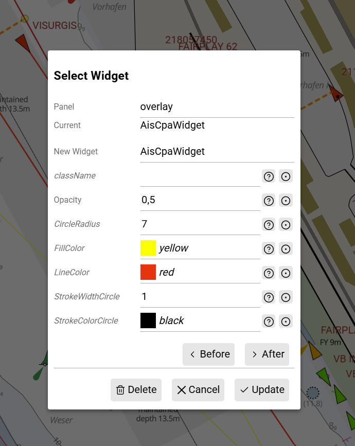
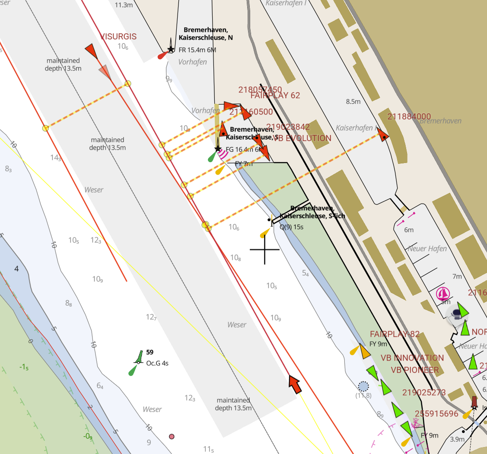

AvNav AIS CPA plugin
====================
Draw AIS CPA on map using [AvNav](https://github.com/wellenvogel/avnav) plugin API (requires at least AvNav 20260104).

Based on [AvNav Testplugin](https://github.com/wellenvogel/avnav-testplugin/tree/master)

Build it 
`./setVersion.sh && ./build.sh`

Upload the zip at the AvNav Plugins tab.

Then widget can be added via *Layouts->Edit Layout->On Map* by selecting *AisCpaWidget*

At AvNav *Display Setting->AIS* disable *curved vectors* and set *relative motion vector range* to 0.

## Configuration

## Example

