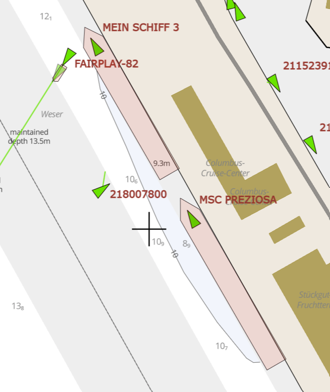
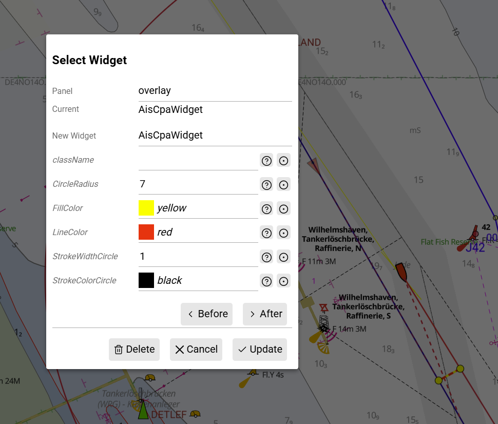
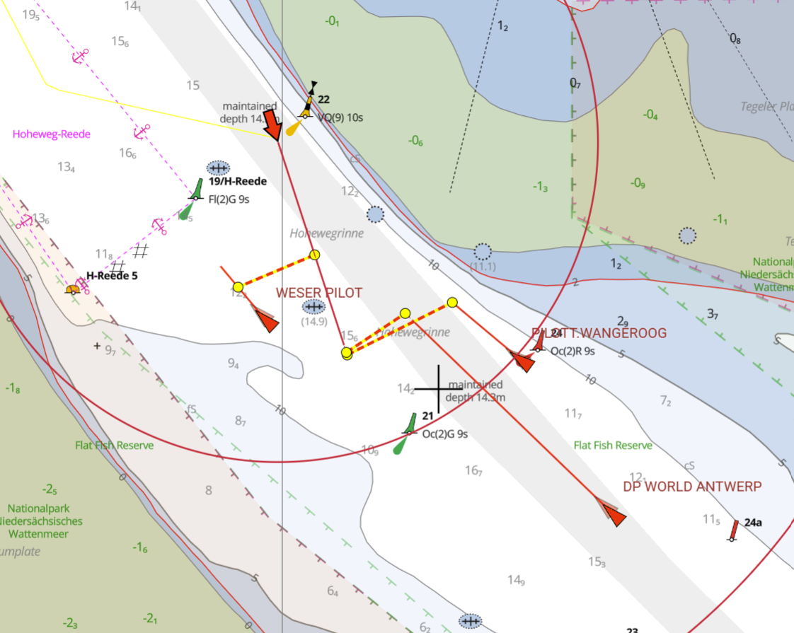
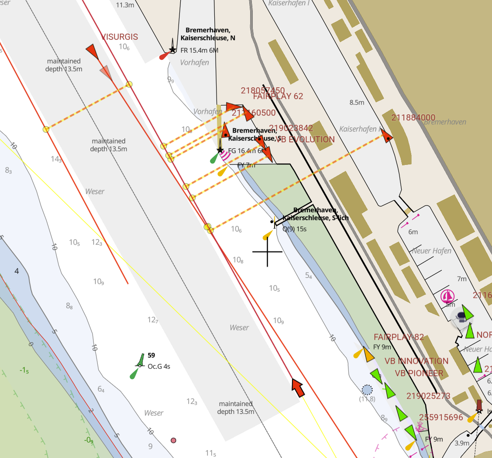
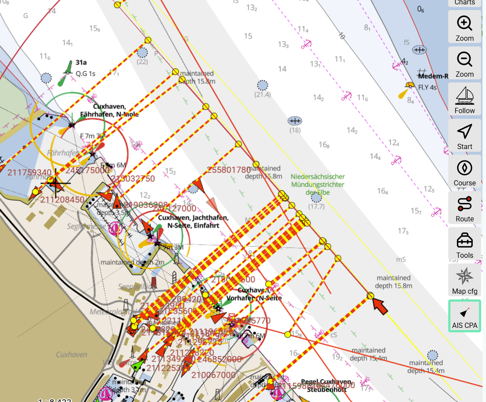
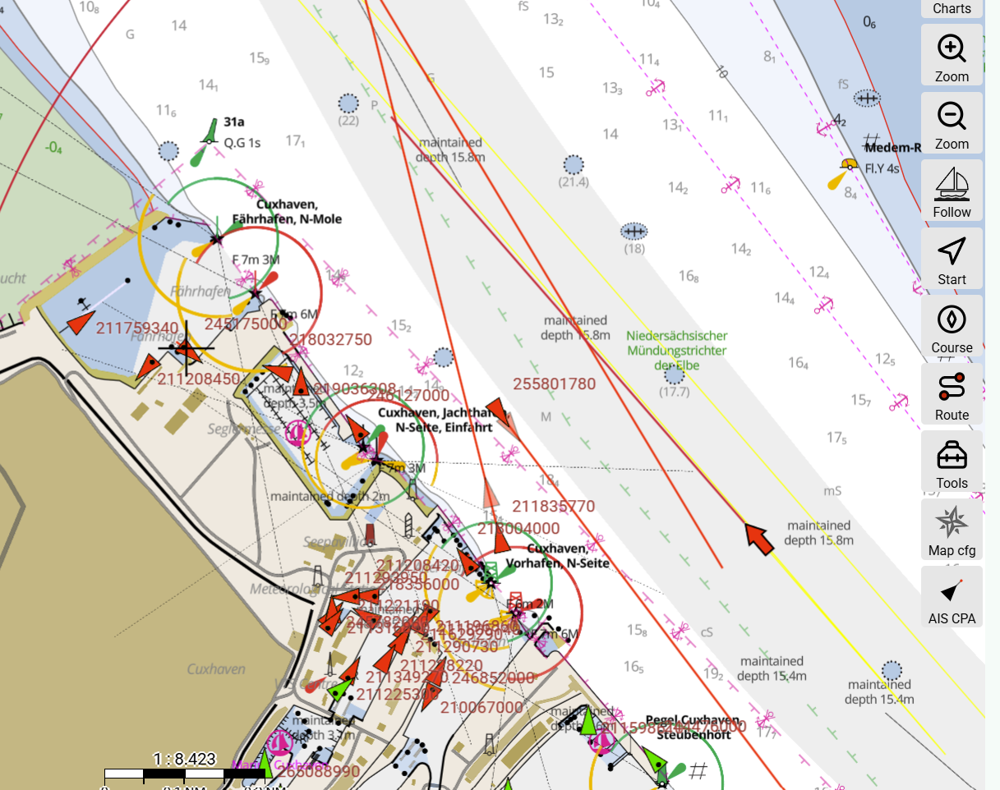
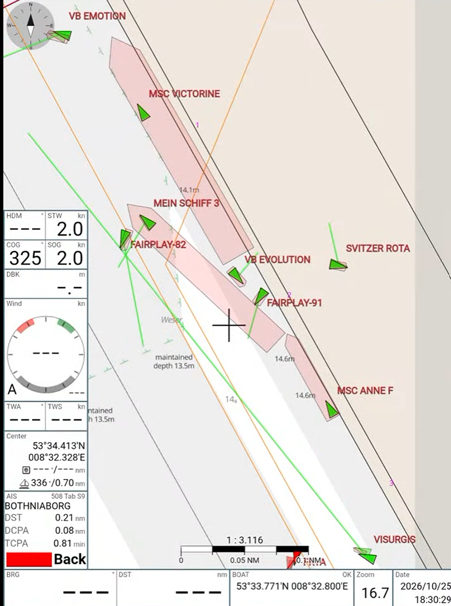

AvNav AIS CPA plugin
====================
Draw AIS CPA on map using [AvNav](https://github.com/wellenvogel/avnav) plugin API (requires at least AvNav 20260104).

Based on [AvNav Testplugin](https://github.com/wellenvogel/avnav-testplugin/tree/master)

Build it 
`./setVersion.sh && ./build.sh`

Upload the release zip file at the AvNav Plugins tab.

Then widget can be added via *Layouts->Edit Layout->On Map* by selecting *AisCpaWidget*

At AvNav *Display Setting->AIS* disable *curved vectors* and set *relative motion vector range* to 0.

## Actual Release

https://github.com/nocheinpeter/avnav-aiscpaplugin/blob/main/releases/avnav-aiscpaplugin-20261113.zip

- bugfix wrong canvas cleanup could overwrite other plugin drawings
- internal refactoring
- check min. AvNav version needed
- minimum zoom needed by user config for drawings

## Actual Beta

https://github.com/nocheinpeter/avnav-aiscpaplugin/blob/beta/releases/avnav-aiscpaplugin-beta.zip
- bugfix wrong canvas cleanup could overwrite other plugin drawings
- internal refactoring
- check min. AvNav version needed
- minimum zoom needed by user config for drawings

## Previous Releases
https://github.com/nocheinpeter/avnav-aiscpaplugin/blob/main/releases/avnav-aiscpaplugin-20261108.zip
- fixed tcpa evalution, sometimes drawing stopped 

https://github.com/nocheinpeter/avnav-aiscpaplugin/blob/main/releases/avnav-aiscpaplugin-20261107.zip
- implemented https://github.com/nocheinpeter/avnav-aiscpaplugin/issues/3
- from AvNav Beta https://www.wellenvogel.net//software/avnav/downloads/daily/20261106/ shows real ship size

## Configuration

## Examples

## Disabling AIS CPA drawings

If it's too much you can disable the CPA drawings:

To disable push the *AIS CPA* button on the right side

Displays real ship sizes:

## FAQ

[FAQ](faq.md)